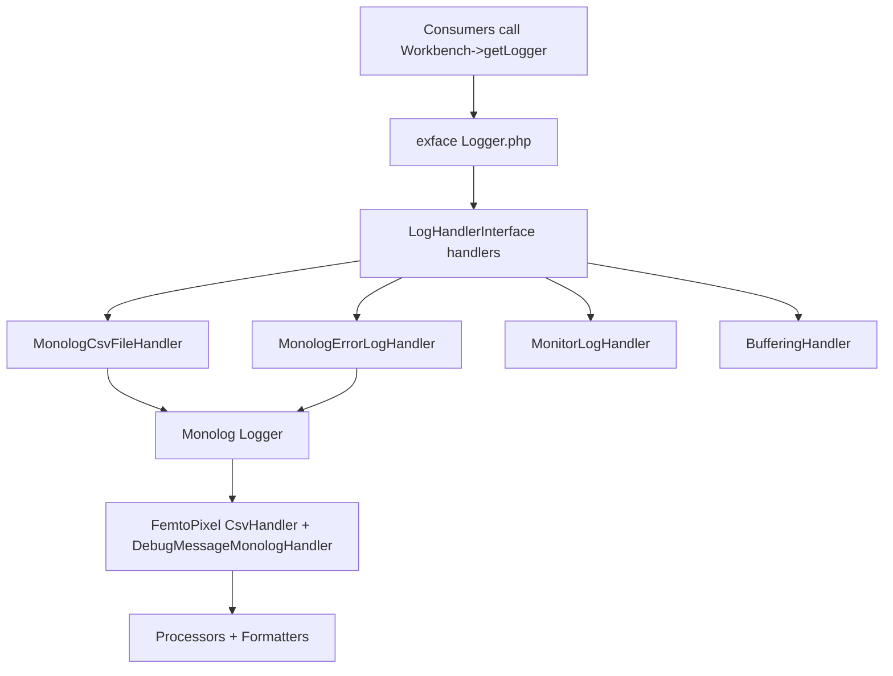

# Logging & Introspection Ecosystem

> Reference map for the Monolog 1.x → 3.x migration.
> Scope: `exface/core/CommonLogic/Log` and its direct dependencies.

## Big picture: two layers

Logging is built as a **thin exface abstraction wrapping Monolog internally**. Consumers never
touch Monolog directly — they go through the exface `LoggerInterface`. This keeps the migration's
blast radius mostly contained inside `CommonLogic/Log`.



## The exface abstraction layer (Monolog-independent)

- `Interfaces/Log/LoggerInterface.php` — extends PSR-3 but adds a custom
  `iCanGenerateDebugWidgets $sender` argument to every method. **Levels are lowercase strings**
  (`'debug'`…`'emergency'`), not Monolog integer constants.
- `Interfaces/Log/LogHandlerInterface.php` — the exface handler contract:
  `handle($level, $message, $context, $sender)`.
- `CommonLogic/Log/Logger.php` — the exface `LoggerInterface` implementation. Notable: a recursion
  guard (`isLogging()` / queue) that defers errors occurring *while* logging, dedup logic in
  `enqueueError()`, and `generateLogId()` (8-char md5).
- `Factories/LoggerFactory.php` — wires everything from `LOG.*` config options; also provides the
  PHP-error_log fallback logger.

## Handlers (implement the exface `LogHandlerInterface`)

| Handler | Monolog-based? | Purpose |
|---|---|---|
| `Handlers/MonologCsvFileHandler.php` | Yes | Main handler. Builds a `Monolog\Logger` → `GroupHandler` (FemtoPixel `CsvHandler` + `DebugMessageMonologHandler`) wrapped in `FingersCrossedHandler` with `ErrorLevelActivationStrategy`. The "accumulate then dump on trigger" behavior. |
| `Handlers/MonologErrorLogHandler.php` | Yes | Wraps Monolog `ErrorLogHandler` → PHP `error_log`. The fallback path. |
| `Handlers/MonitorLogHandler.php` | No | Writes to the `exface.Core.MONITOR_ERROR` meta object (DB). Uses `DebugWidgetProcessor` directly. |
| `Handlers/BufferingHandler.php` | No | Buffers all entries, flushes on `__destruct`. |

## Monolog adapters — the migration hotspots

These directly extend/implement Monolog classes, so they break with the v2/v3 `LogRecord` object model:

- `Monolog/DebugMessageMonologHandler.php` — extends `AbstractProcessingHandler`, overrides
  `write(array $record)`. Dumps each debug widget to a separate JSON file.
  **`write()` signature changes to `LogRecord` in v2/v3.**
- `Monolog/MessageOnlyFormatter.php` — implements `FormatterInterface`, `format(array $record)`.
  **Signature changes to `LogRecord`.**

## Processors (all `__invoke(array $record)`)

`Processors/AbstractColumnPositionProcessor.php` and its subclasses — `ActionAliasProcessor`,
`RequestIdProcessor`, `UserNameProcessor`, `IdProcessor`, `ContextFilterProcessor`,
`DebugWidgetProcessor`.

They treat the record as an **ordered array and reorder keys via `array_slice`** to position
columns in the CSV. This is the most fragile area — in v3 records are immutable `LogRecord`
objects, so this reordering approach needs a rethink.

## Housekeeping (no Monolog dependency)

`CommonLogic/Log/LogCleaner.php` — cron-driven cleanup of expired `.log` / `.json` / trace files,
plus broken-CSV-line **repair**. The *cleanup* is unaffected by Monolog, but the *repair* logic is
**not** format-safe (it judges lines by comma count, not by parsing CSV — see "Additional correctness
risks" below). So `LogCleaner` is only partly "safe from the migration".

## On-disk storage contract (must be preserved)

This upgrade is **not** a change of storage backend. The daily CSV files and their JSON detail files
are a hard compatibility contract: stored logs must stay readable as `exface.Core.LOG_ENTRY`, and the
UI loads `log/details/<date>/<log-id>.json` using the log ID found in a CSV row.

**File layout**

- One daily `<date>.log` CSV file plus a matching `details/<date>/` directory.
- No header row; UTF-8 text.
- Delimiter `,` (comma), enclosure `'` (apostrophe), escape `\` (backslash) — these come from the
  FemtoPixel `CsvHandler` constants on the write side. On the read side `CsvBuilder` (which wraps
  `league/csv ^9.6`) defaults its enclosure to `"`, so the `exface.Core.LOG_ENTRY` object must
  override delimiter/enclosure to match the writer. **Writer and reader settings are coupled — keep
  them in lockstep.**
  - **Escape strategy (in scope, approved):** evaluate moving the first-party writer to an *empty*
    proprietary escape char with standard enclosure doubling, but only if a `league/csv` round-trip
    of apostrophes/backslashes/commas/newlines proves reader compatibility. If it does not, keep the
    legacy backslash escape and document/test that mode. The escape choice must be proven against
    `CsvBuilder`, never assumed.

**Column order (physical, 0-indexed).** The first ten columns are mapped by `exface.Core.LOG_ENTRY`;
column 10 is retained for compatibility even though it is not modeled. This order is produced today by
the processors (which prepend columns 0–3) followed by `NormalizerFormatter` (columns 4–10):

| Index | Value | Source |
|---:|---|---|
| 0 | Log ID | `IdProcessor` |
| 1 | Request ID | `RequestIdProcessor` |
| 2 | User name | `UserNameProcessor` |
| 3 | Action alias | `ActionAliasProcessor` |
| 4 | Message | record `message` |
| 5 | Context as JSON | record `context` (after `ContextFilterProcessor` strips `exception`/`sender`) |
| 6 | Numeric Monolog level | record `level` |
| 7 | Uppercase level name | record `level_name` |
| 8 | Channel | record `channel` |
| 9 | Timestamp `Y-m-d H:i:s.v` | record `datetime` (ms precision) |
| 10 | Extra data as JSON | record `extra` |

**Integrity rules**

- Every persisted CSV row keeps the same log ID as its detail JSON filename.
- **Publish ordering (approved behaviour change):** the detail JSON must be written and confirmed
  **before** the CSV row is appended. A CSV row referencing a missing/partial detail file is never
  acceptable; an orphan detail file with no CSV row *is* acceptable (retention cleans it up). This
  replaces the current `GroupHandler` approach, where the CSV and detail handlers run effectively in
  parallel and rely on the `file_exists` guard.
- Existing detail files for a given log ID must never be truncated or appended to.
- Old `.log`/detail files must remain readable; no data migration for existing files.
- Buffering semantics are preserved: collect from `LOG.MINIMUM_LEVEL_TO_LOG`, flush the buffer at
  `LOG.PERSIST_LOG_LEVEL`, independently persist at `LOG.PASSTHROUGH_LOG_LEVEL`.
- The PHP `error_log` fallback stays operational when init or file persistence fails.

## Migration risk summary (v1 → v3)

### 1. Record model

**What it means:** A "record" is the data structure Monolog passes through the pipeline for a
single log entry — it carries the message, level, channel, timestamp, `context` (data supplied at
the call site) and `extra` (data added by processors). In Monolog 1.x this is a **plain PHP
associative array** (`$record['message']`, `$record['context']`, …). In Monolog 3.x it is an
**immutable `Monolog\LogRecord` object** with typed, read-only properties accessed as
`$record->message`, `$record->context`, etc. Because it is immutable, you no longer mutate it in
place; you call `$record->with(...)` to get a modified copy.

**Why it is a risk here:** Every piece of custom code in this ecosystem reads and writes the record
as an array. The switch touches all 7 processors, both formatters, and
`DebugMessageMonologHandler::write()` — each of them needs to move from array access to object
access (and from in-place mutation to `->with()`).

### 2. Column reordering

**What it means:** The CSV log is a table where each field (id, requestId, userName, actionAlias,
message, …) is a column. `AbstractColumnPositionProcessor` controls **which column each value lands
in** by exploiting the fact that a PHP array preserves insertion order: it uses `array_slice` to
splice new keys into a specific position among the existing record keys.

**Why it is a risk here:** A `LogRecord` object has a *fixed* set of properties and no arbitrary
top-level ordering to manipulate — you can't `array_slice` an object. Extra fields now live inside
the `extra` array rather than as sibling keys of `message`/`level`. So the whole "insert this column
before that one" technique has to be redesigned (most likely: write everything into `extra` and let
the formatter decide the CSV column order explicitly).

**Read-back coupling (do not break this):** the CSV column order is not just cosmetic — it is parsed
back on the read side. `Debugger::getLogData()` reads stored entries through the `exface.Core.LOG`
and `exface.Core.LOG_ENTRY` metamodel objects, which map **by column position**. If the migration
changes the CSV column order, the `LOG_ENTRY` object's column mapping must be updated in lockstep, or
the log/introspection UI will silently mis-map fields (e.g. show the user name under "message").
Keep the written column order and the `LOG_ENTRY` parsing in sync. The concrete reader is
`QueryBuilders/CsvBuilder.php` (wrapping `league/csv`), so verify any format change against *that*
parser, not against `explode()` or line counting.

### 3. Levels

**What it means:** A log "level" is the severity of an entry (debug, info, …, emergency). Monolog
1.x represents levels as **integer constants** (`Logger::DEBUG = 100`) and
`Logger::toMonologLevel()` converts a string/PSR-3 level into that integer. Monolog 3.x replaces
the integers with a **`Monolog\Level` enum** (a typed PHP 8.1 enum), and `toMonologLevel()` now
returns a `Level` instance instead of an `int`.

**Why it is a risk here:** Several handlers call `Logger::toMonologLevel($this->minLevel)` and pass
the result into Monolog handler constructors and comparisons. Those call sites keep working only if
they treat the result as a `Level` rather than an `int` (e.g. no arithmetic or integer type hints on
the result). `DataTypes/LogLevelDataType.php` also depends on the old `Logger::getLevelName()` /
`getLevels()` / `toMonologLevel()` helpers and must be ported to `Level` conversions — while keeping
its public behaviour (PSR-3 strings at exface interfaces, numeric values only where the metamodel
asks for them).

### 4. Namespaces / constructors

**What it means:** Between v1 and v3 Monolog moved and reshaped several classes. Two used here:
- `ErrorLevelActivationStrategy` moved namespace (into `Monolog\Handler\FingersCrossed\…`) and its
  argument became a `Level`.
- `FingersCrossedHandler` — the handler that buffers entries and only "fires" the full dump once a
  trigger level is reached — changed its constructor parameters/types.

**Why it is a risk here:** `MonologCsvFileHandler` constructs both of these directly with positional
arguments. The `use` imports and constructor calls must be updated to the v3 signatures, or the
handler will fail to instantiate.

### 5. External dependency

**What it means:** `femtopixel/monolog-csvhandler` is a **third-party package** (not exface code)
that provides the `CsvHandler` used to actually write the CSV file. It extends Monolog's
`StreamHandler` and overrides `streamWrite($resource, array $record)`, reading `$record['formatted']`
— i.e. it is written against the Monolog 1.x array-record API.

**Why it is a risk here:** We cannot simply edit our own code to fix it; it is a vendor dependency.
It targets Monolog 1.x and likely has no v3-compatible release. Composer currently pins
`femtopixel/monolog-csvhandler: "~0.1"` (the writer) alongside `league/csv: "^9.6"` (the reader).
The chosen direction is to **remove FemtoPixel entirely and write a first-party Monolog 3 CSV
handler + formatter** with the explicit 11-column schema above — not to fork its Monolog 1
implementation just to satisfy type signatures.

### 6. PHP requirement

**What it means:** Monolog 3 raises its minimum platform to **PHP 8.1+** (it relies on enums,
readonly properties and other 8.1 features).

**Why it is a risk here:** The upgrade is gated on the whole workbench running on PHP 8.1 or newer.
If any target environment is still on an older PHP, the Monolog 3 upgrade cannot proceed there — so
the runtime PHP version must be confirmed before committing to v3 (v2 would be the fallback for
PHP 8.0).

**Composer specifics:** core currently declares `"php": "^8"` and `"monolog/monolog": "^1.22.1"`.
Target is `monolog/monolog: ^3.12`, which also requires **PSR Log 2 or 3** (core currently pulls PSR
Log 1) — so the `php` constraint must be raised to an explicit `^8.1` and the PSR Log major allowed
to float to what the full dependency graph selects. Run `composer why-not monolog/monolog 3.12.0`
(and the PSR Log equivalent) from the application root first to surface transitive blockers.

**Decision (approved):** PHP 8.0 support is **dropped**. The target floor is PHP 8.1+, so Monolog 3
is a valid target and the v2 fallback is no longer under consideration.

## Additional correctness risks (surfaced by the execution plan)

These are latent file-I/O defects independent of the Monolog version, but the migration rewrites
exactly this code, so they should be fixed in the same pass rather than carried forward.

### 7. Concurrent writes are not locked

The current CSV write path calls `fputcsv()` **without stream locking**. Concurrent web requests
appending to the same daily `<date>.log` are a plausible cause of partial or interleaved rows. The
first-party writer should take an **exclusive lock around each complete record append**, and treat a
short/failed write as an exception so the fallback logger reports it. This must be stress-tested with
multiple workers before *and* after the change.

### 8. Detail-file persistence is not atomic

`DebugMessageMonologHandler::write()` checks `file_exists()` and then streams the JSON directly. This
**check-then-write race**, or a process interruption mid-write, can leave a partial/corrupt
`<log-id>.json`. The fix is atomic: write to a uniquely-named temp file in the target dir, flush,
validate with `json_decode(..., JSON_THROW_ON_ERROR)`, then atomically rename to `<log-id>.json`
using exclusive create/lock. Treat an already-valid final file as success; never append/overwrite.

### 9. "Repair" does not actually parse CSV

`LogCleaner`'s repair judges lines by **comma count** (`substr_count($line, ',') >= 10`), which is not
CSV parsing: quoted commas and valid embedded newlines make it unreliable, so a "repair" can delete
*valid* multiline records. Replace the heuristic with parser-based validation using the same
`league/csv` settings as `CsvBuilder` (comma/apostrophe, embedded newlines), validate exactly eleven
fields + identifiers + level + timestamp + JSON, back up/quarantine before rewriting, and report
*logical record* numbers rather than physical line numbers.

## Latent risk: exFace handlers are appended without deduplication

Handlers are **injected from outside** — the classes that need a sink construct a handler and push
it onto the shared `Logger`. But `Logger::appendHandler()` does a raw append with no identity or
class check, and `removeHandler()` matches only by strict object identity (you must hold the exact
instance to remove it):

```
public function appendHandler(LogHandlerInterface $handler): LoggerInterface|static
{
    $this->handlers[] = $handler;   // no identity/class/sink check
    return $this;
}
```

**Consequence:** if two sources independently register a handler of the same class pointing at the
same destination, **every entry is logged twice**. The `log()` loop simply iterates all handlers.

This does not blow up today only because of **low traffic to the registration paths** (each is
called exactly once in practice) — *not* because anything prevents it. There is no systemic guard;
the "no duplicates" invariant is emergent, not enforced.

**IMPORTATNT:** This only affects exFace handlers. Native MonologHandlers are fine.

### Where exFace handlers are appended (quick reference)

| Call site | Handler appended | What stops double-registration today |
|---|---|---|
| `Factories/LoggerFactory.php` `createDefaultLogger()` | `MonologCsvFileHandler` | `static::$logger` singleton — handler built only on first call |
| `Factories/LoggerFactory.php` `createPhpErrorLogLogger()` | `MonologErrorLogHandler` | `static::$fallbackLogger` singleton (separate logger instance) |
| `CommonLogic/Monitor.php` `registerLogHandler()` (via `register()`) | `MonitorLogHandler` | Nothing in `register()` itself — safe only because `Workbench` calls it once |
| `CommonLogic/Tracer.php` `registerLogHandlers()` | `BufferingHandler(MonologCsvFileHandler)` | Nothing — safe only because it is called once per trace |

### Partial mask to be aware of

`DebugMessageMonologHandler::write()` short-circuits on `file_exists()` keyed by log id, so duplicate
**detail JSONs** are suppressed — but duplicate **CSV rows** are not. A double-registration therefore
shows up as *doubled CSV lines with single JSON details*, which is a confusing symptom to diagnose.

### Root cause: "singleton" handlers in a framework that does not enforce it

Not all duplicates are equal. Native Monolog handlers are contractually **decoupled sinks** — the
record is passed by value (immutable `LogRecord` in v3) and each handler owns its own processor
stack — so a duplicate is merely *redundant output*, never corruption. The exFace `MonologErrorLogHandler` sits
at that benign end too (it just writes to the OS `error_log`).

The problem is the **two stateful handlers**, which are effectively designed as **singletons** —
they assume exactly one instance exists — yet nothing in the injection mechanism enforces that:

- `MonitorLogHandler` holds the shared `Monitor` object and performs **non-idempotent DB inserts**
  (`$ds->dataCreate()`), mutates shared state via `addLogIdToLastRowObject()`, and carries
  `busy` / `failed` flags that assume it alone owns the "disable monitor on failure" decision. A
  duplicate produces **doubled `MONITOR_ERROR` rows and corrupted shared state**, not just noise.
- `MonologCsvFileHandler` owns a file handle to a **shared `.log` path** plus its **own**
  FingersCrossed buffer, so duplicates buffer and flush independently against the same file.

The exface **processors** share this assumption: they are **not idempotent** (e.g. `IdProcessor`
unsets then re-keys `context['id']`; `AbstractColumnPositionProcessor` splices by key order), so they
too are built for a single pass. And `Logger::log()`'s self-healing (`unset($this->handlers[$i])` on
a throwing handler) treats handlers as distinct, non-interchangeable units.

**Architectural note:** this mismatch suggests the **dependency-injection / append pattern may be the
wrong fit** for these handlers. A singleton-style component that owns a unique sink and shared state
should arguably be *registered by identity/sink* (a keyed registry or a `getOrCreate`-style
accessor), not blindly pushed onto a list. The injection pattern works for genuinely decoupled
sinks (Monolog's model); it does not match handlers that are single-owner by design.

### Suggested fix

Make `appendHandler()` deduplication-aware instead of relying on call-site luck:

- Add a `hasHandler()` / sink-aware guard so appending an equivalent handler is a no-op (or at least
  logs a warning). Equivalence can be identity for the simple case, or a handler-provided key
  (class + destination path/sink) for the stronger case.
- Optionally let `LogHandlerInterface` expose a stable identity (e.g. `getSinkId()`) so the `Logger`
  can compare destinations, not just object instances.

This is **version-independent** hardening, but especially worth doing before the migration: rebuilding
the handler stack for v3 is exactly the kind of change that could accidentally introduce a second
registration, and there is currently no safety net to catch it.

## Cleanup items (worth folding into the migration)

These are not strictly required for the Monolog upgrade, but the upgrade touches exactly this code,
so they are cheap to fix along the way.

### `DEBUG.PRETTIFY_ERRORS` secretly gates PHP-error logging

The **only** active bridge that routes PHP errors into the logger lives in
`Debugger::setPrettifyErrors()` — the `setDefaultLogger(...)` + `ErrorHandler::register(...)` calls
sit **inside** the `if ($value === true)` block:

```
protected function setPrettifyErrors(bool $value) : DebuggerInterface
{
    $this->prettify_errors = $value;
    if ($value === true) {
        $handler = new ErrorHandler(null, $this->prettify_errors);
        $handler->setDefaultLogger($this->logger, $this->error_reporting); // the error -> logger bridge
        ErrorHandler::register($handler, true);
    }
    return $this;
}
```

So a flag named `PRETTIFY_ERRORS` conflates two unrelated concerns: (1) **cosmetic** pretty error
pages, and (2) **functional** registration of the PHP-error -> logger bridge. The default is
`DEBUG.PRETTIFY_ERRORS = false`, which means **out of the box, uncaught PHP errors/warnings are not
routed into the exface log at all**. Anyone who turns prettification off to get plain error output
also silently disables error logging.

Uses Symfony's `ErrorHandler` (`Symfony\Component\ErrorHandler\ErrorHandler`), not Monolog's — so it
is not directly affected by the Monolog version, but it is the single point where PHP errors enter
the logging pipeline.

**Suggested fix:** decouple the two concerns — introduce a dedicated option (e.g.
`DEBUG.LOG_PHP_ERRORS`) that controls the error -> logger bridge independently of prettification.

### Dead code: `LoggerFactory::registerErrorLogger()`

`LoggerFactory::registerErrorLogger()` would register **Monolog's** `ErrorHandler`, but it is
**never called anywhere** and calls an undefined `getErrorLogger()` method (it would fatal if
invoked). It looks like an abandoned "always-on Monolog error bridge" that was superseded by the
Symfony handler above. Since the migration will touch Monolog's `ErrorHandler` anyway, either delete
this method or finish it as the intended always-on bridge (which would also fix the
`PRETTIFY_ERRORS` gap above).

## Execution plan (approved)

The migration is executed as **one** change set — the FemtoPixel removal, the `LogRecord`/`Level`
port, and the file-I/O hardening cannot land independently. Scope decisions above are all approved:
PHP 8.0 dropped, detail-before-CSV publish ordering adopted, FemtoPixel replaced by a first-party
writer, escape strategy to be proven against `CsvBuilder`.

1. **Baseline oracle.** Build a *temporary, uncommitted* harness around the current logger. Feed
   adversarial values (empty, commas, apostrophes, double quotes, backslashes, CR/LF/CRLF, tabs,
   Unicode, long messages, nested context, exceptions, JSON-normalised values). Parse output with the
   same `league/csv` settings as `CsvBuilder` (not `explode()`), assert exactly 11 fields, and keep
   representative *valid* output as the compatibility oracle. Also run multi-worker writes to measure
   the real corruption mode (concurrency vs. escaping vs. shutdown).
2. **Platform & Composer.** Raise `php` to `^8.1`; require `monolog/monolog:^3.12` + compatible PSR
   Log; remove `femtopixel/monolog-csvhandler`. Resolve with `composer why-not` first; review the
   full lock diff.
3. **First-party CSV writer + formatter** (`CommonLogic/Log/Monolog`). Emit the exact 11 columns
   explicitly — never a generic `LogRecord::toArray()`. Convert `Level` to numeric + uppercase name,
   format the timestamp explicitly, JSON-encode context/extra with throw-on-failure, strip
   `exception`/`sender` from the CSV context only. Enable **exclusive stream locking** per record;
   treat short/failed writes as exceptions.
4. **Atomic detail persistence + ordering.** Port `DebugMessageMonologHandler` to v3; write detail
   JSON to a temp file → validate with `JSON_THROW_ON_ERROR` → atomic rename, exclusive create. Wire a
   core-owned **composite handler** that persists/confirms the detail file **before** appending the
   CSV row, wrapped in the existing `FingersCrossedHandler` so buffering/passthrough are unchanged.
5. **Port all integration points to `LogRecord`/`Level`.** All processors return `LogRecord`
   (enrichment into `extra`, no invented properties); `MessageOnlyFormatter` to the v3 signatures;
   `DebugMessageMonologHandler::write()` to the v3 signature. Extract a standalone detail-JSON
   generator from `DebugWidgetProcessor` and have **`MonitorLogHandler` call that explicit method**
   instead of invoking the processor with a hand-built array. Port `LogLevelDataType`. Verify
   `MonologErrorLogHandler`, `ErrorLogHandler`, `GroupHandler`-or-replacement, and the exact v3
   `FingersCrossedHandler` constructor. Keep the exface `LoggerInterface` + sender arg stable — no
   Monolog types leak to callers.
6. **Parser-based repair** (see risk #9). Validate with `league/csv`, quarantine before rewrite,
   report logical-record numbers. Keep repair for at least one release post-migration.
7. **Verify & roll out.** Compare behaviour against the oracle (decoded values, not raw bytes).
   Deploy to a test environment with representative concurrent traffic for ≥ one retention/cleanup
   cycle before general rollout. Roll back code + Composer lock together (the unchanged on-disk
   contract lets the old version read new files).

## Test matrix

| Area | Must verify |
|---|---|
| CSV round-trip | All adversarial values decode via `CsvBuilder` to exactly 11 fields in documented order; level numeric+name, timestamp format, valid context/extra JSON. |
| Detail files | Every row's log ID resolves to valid `details/<date>/<id>.json`; renders in the existing dialog; `exception`/`sender` excluded from CSV but present in details. |
| Buffering | Below-min dropped; collected-but-untriggered stays buffered; `PERSIST` flushes the buffer incl. trigger; `PASSTHROUGH` persists independently and exactly once; normal + exception-driven shutdown. |
| Concurrency | Multi-worker same-file writes: no missing/dup/truncated/interleaved rows, unique IDs, valid matching details; repeated to force contention. Same-ID detail writes never mutate an existing file. |
| Failure/interruption | Unwritable dir, detail/CSV write failure, malformed UTF-8/JSON, init failure, termination between temp-detail and publish → reach `error_log` fallback, never publish a dangling CSV row. |
| UI / old files / repair / retention | Log viewer filters/sorts modeled columns + opens details for ordinary/exception/fallback entries; pre-upgrade files still readable; repair preserves valid multiline records + quarantines; cleanup removes only expired data. |

**Acceptance gate:** Composer resolves Monolog 3.12.x without FemtoPixel or ignored platform reqs;
`php -l` passes on every changed file; startup produces no deprecations/handler-init fallback; all
matrix rows pass. Unavailable checks are marked *unverified*, not *passed*. Core has no unit-test
suite — reuse Behat where a scenario fits and retain a documented manual verification matrix.

## Files expected to change

- `composer.json` + installation-level Composer lock
- `Factories/LoggerFactory.php`
- `CommonLogic/Log/Handlers/MonologCsvFileHandler.php`
- `CommonLogic/Log/Handlers/MonologErrorLogHandler.php`
- `CommonLogic/Log/Handlers/MonitorLogHandler.php`
- `CommonLogic/Log/Monolog/DebugMessageMonologHandler.php`
- `CommonLogic/Log/Monolog/MessageOnlyFormatter.php`
- `CommonLogic/Log/Processors/*.php`
- `CommonLogic/Log/LogCleaner.php`
- `DataTypes/LogLevelDataType.php`

No `exface.Core.LOG_ENTRY` metamodel change is expected. If validation proves its current
enclosure/escape cannot safely represent the required values, any format change must be a **separate**
backward-compatible migration with dual-read support — not folded silently into the Monolog upgrade.

## Testing and Cleanup

Finalization checklist. The baseline oracle harness (step 1) lives outside the repo, in the
Copilot session folder `files\oracle\` (copy it somewhere permanent if needed). Results from the
Monolog 1 baseline are in `out\`.

**Verify against the oracle**
- [ ] `corpus.php`: all 41 baseline-OK cases decode to the same values as `out\corpus\oracle.json`
      (compare decoded fields; ignore request ID, user, action and timestamp values).
- [ ] `corpus.php`: the 5 baseline-BROKEN cases now pass (`bslash_apos`, `bslash_apos_end`,
      `ctx_bad_utf8`, `ctx_bslash_apos`, `win_path_quoted`).
- [ ] Decide and document whether message backslash doubling (`handle()`) is kept.
- [ ] `stress.php` (8×300 ×3, 16×300 ×2): 0 missing, corrupted or unattributed rows
      (baseline lost ~1.8%).
- [ ] `stress.php` with kill (1 worker, several delays): no CSV row without a valid detail JSON.
- [ ] `repair_sim.php` / new repair on `corpus.log`: no valid multi-line record destroyed.
- [ ] Remaining test matrix rows and acceptance gate above checked; unverified items marked as such.

**Remove temporary re-routes**
- [ ] Root `composer.json`: set `exface/core` back to `dev-1.x-dev as 1.0`.
- [ ] Root `composer.json`: remove the `hail-cookies/Core.git` `vcs` repository.
- [ ] `composer update exface/core` and confirm the lock points at `ExFace/Core` again.
- [ ] Confirm no harness files or oracle outputs were committed.
